# Architecture Visual — Mini-App Super-App

> Generated 2026-08-30 against `policy/budgets.md:68` low-tier Galaxy A14 and `policy/capabilities.yaml:78` 6-capability registry. All numbers/budgets imported from `src/config/budgets.ts:1` (single source; CI reads `policy/budgets.md:14`).

Render with any Mermaid renderer (GitHub, VS Code, `npx mermaid`). An interactive copy is at `architecture-visual.html`.

---

## 1 — Overall Architecture (C4 L1/L2)

The thesis from `CLAUDE.md:4`: **release agility** (native cannot roll back) + **trust** (one audited door). Downward = decreasing trust, upward = decreasing release agility.

```mermaid
flowchart TB
    subgraph Shell ["Native Shell — thin, ships via store, cannot roll back<br/>App.tsx:174 applyShellChrome · src/native/nativeShell.ts:19"]
        Launch["Launch / Splash<br/>tap→splash 50ms p50 / 100ms p95<br/>policy/budgets.md:80"]
        PermSheets["Permission Sheets<br/>OS prompt is 1-shot, per-host-app<br/>src/native/deviceAccess.ts"]
        HostStorageNative["HostStorage NativeModule<br/>src/native/hostStorage.ts:10"]
    end

    subgraph RNHost ["React Native Host — remotely updatable OTA<br/>App.tsx:132 App() orchestration"]
        App["App.tsx:132 — state hub<br/>navigationRef, dock, homePrefs, tenant, notification, tracking"]
        NavBroker["navigationBroker.ts:21 — pure state machine<br/>openDock / navigate / crossApp / notification"]
        Screens["Screens<br/>HomeScreen.tsx:92 · MiniAppScreen.tsx:38<br/>PlaceholderScreen.tsx"]
        TabBar["GlassTabBar.tsx:20 — dock L/R + Explore"]
        TenantHook["useTenant.ts:12 — location-first resolve"]
        TenantCfg["tenants.ts:32 — 4 tenants, haversine"]
        TrackingSvc["TrackingService.ts:297 — journal, batch, transport"]
        NotifSvc["NotificationService.ts:246 — inbox, foreground, retry"]
        BridgeJS["Bridge types/registry<br/>src/bridge/types.ts:14 · registry.ts:24"]
    end

    subgraph BridgeLayer ["Capability Bridge — the ONLY door<br/>src/bridge/handler.ts:47 10-step pipeline"]
        Registry["registry.ts:24 CAPABILITIES[6]<br/>net.request storage.kv scanner.scan<br/>location.current crypto.sign notify.subscribe"]
        Handler["handler.ts:47 handleBridgeRequest<br/>1 identity 2 origin 3 G1 4 args 5 G2 6 G3 7 quota 8 exec 9 audit 10 reply"]
        Gates["gates.ts:15 G1 declaration<br/>gates.ts:32 G2 consent<br/>gates.ts:51 G3 OS permission<br/>gates.ts:64 quota bucket"]
        Handlers["handlers/*<br/>netRequest.ts storageKv.ts<br/>scanner.ts locationCurrent.ts<br/>cryptoSign.ts notifySubscribe.ts"]
        Audit["audit.ts — hash-chain, argsDigest"]
    end

    subgraph ContainerLayer ["Container — one WebView per mini-app, one origin each<br/>src/miniapps/container/"]
        Factory["MiniAppContainer.tsx:63 ONLY factory (C1)<br/>incognito + storage off + renderer death"]
        Config["containerConfig.ts:12 CONTAINER_CONFIG<br/>domStorageEnabled=false incognito=true"]
        CSP["csp.ts:25 buildCspHeader<br/>response header, never meta (B2)"]
        NavGuard["navigationGuard.ts:30 decideNavigation<br/>scheme+host+declared-route allowlist"]
        WarmPool["warmPool.ts:43 WarmPool<br/>live 1-2 pooled 0-1 by memoryClass"]
        Signer["signer.ts:63 signPackage / verifyPackage (B5)"]
        Validator["validator.ts:21 validateManifest (C9)"]
        Review["pipeline/review.ts:35 reviewPackage 7 checks"]
    end

    subgraph Policies ["Policy — CI-enforced, single source"]
        Budgets["policy/budgets.md:68 budgets + policy/conformance.md:35 C1-C9 R1-R3 B1-B10"]
        CapsYaml["policy/capabilities.yaml:22 tiers + never_expose"]
    end

    subgraph MiniApps ["Untrusted Tenants — WebView origin-isolated"]
        Catalog["catalog.ts:44 miniAppCatalog[6]<br/>badminton weather transit notes market card"]
        CatalogTenant["catalogTenant.ts — per-tenant featured filter"]
        HomeModel["homeModel.ts:18 — categories + pin model"]
        CardsDomain["cards/* — example domain, daily refresh"]
    end

    Shell --> RNHost
    RNHost --> BridgeLayer
    BridgeLayer --> ContainerLayer
    ContainerLayer --> MiniApps
    Policies -. enforces .-> BridgeLayer
    Policies -. enforces .-> ContainerLayer
    Policies -. enforces .-> RNHost

    classDef shell fill:#0f172a,stroke:#38bdf8,color:#e2e8f0
    classDef host fill:#1e3a5f,stroke:#60a5fa,color:#e2e8f0
    classDef bridge fill:#7c2d12,stroke:#fb923c,color:#fff7ed
    classDef container fill:#14532d,stroke:#4ade80,color:#ecfdf5
    classDef policy fill:#422006,stroke:#facc15,color:#fefce8
    classDef untrusted fill:#4a044e,stroke:#e879f9,color:#fdf4ff
    class Shell,Launch,PermSheets,HostStorageNative shell
    class RNHost,App,NavBroker,Screens,TabBar,TenantHook,TenantCfg,TrackingSvc,NotifSvc,BridgeJS host
    class BridgeLayer,Registry,Handler,Gates,Handlers,Audit bridge
    class ContainerLayer,Factory,Config,CSP,NavGuard,WarmPool,Signer,Validator,Review container
    class Policies,Budgets,CapsYaml policy
    class MiniApps,Catalog,CatalogTenant,HomeModel,CardsDomain untrusted
```

**Invariants mapped:**
1. Thin shell → `nativeShell.ts:19` only chrome + haptics; all thresholds from remote config `appConfig.ts:13` (Invariant 1)
2. Only door → no direct `fetch`/`fs` in mini-app; every `fetch` goes via `handlers/netRequest.ts` host-mediated to exact `egressHosts` (Invariant 2, `conformance.md:36` C2-C4)
3. Budgets in CI → `budgets.ts:1` single source, `budgets.md:14` says CI reads file (Invariant 3)
4. Untrusted until signed → `signer.ts:81 verifyPackage` before first script (B5), `container/MiniAppContainer.tsx:114` refuses to render if not verified (Invariant 4)

Reference devices: `policy/budgets.md:48` — low Galaxy A14, mid A54, high iPhone 14. Trace markers: `policy/budgets.md:58` + `budgets.ts:45`.

---

## 2 — Per-Component Architecture

### 2.1 Module map (src layout)

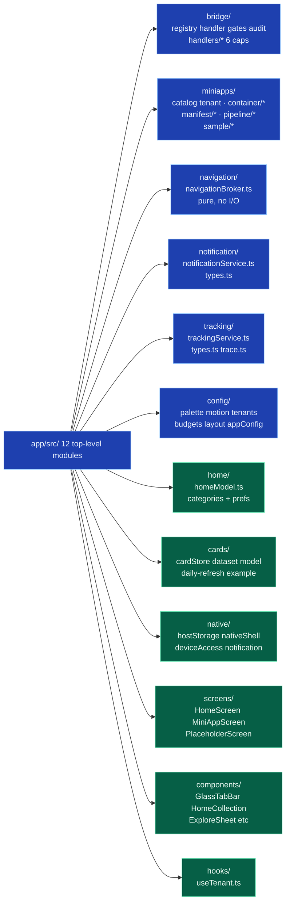

### 2.2 Bridge — 10-step pipeline (bridge-wiring)

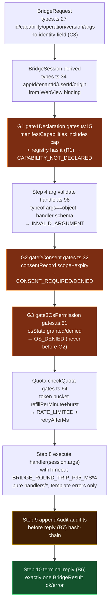

Registered capabilities `registry.ts:24` / `capabilities.yaml:78`:
`net.request:60/10` · `storage.kv:120/20` · `scanner.scan:10/2 host_scanner once` · `location.current:6/2 once high, coarse only` · `crypto.sign:10/3 biometric once high` · `notify.subscribe:5/2 while_using` — each `owner: platform` `audit: call/call_with_result`.

### 2.3 Container — isolation factory (container-wiring)

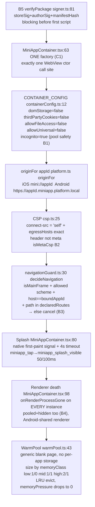

Containment: `C6` no Intent parsing, `C7` no RN scroll handler on WebView, `B1` storage asserts off at construction.

### 2.4 Navigation broker — pure state machine

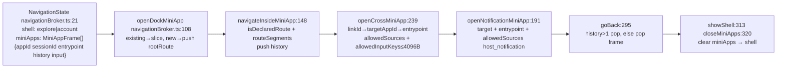

App.tsx commits via `commitNavigation:158` + dedupes `sameVisibleMiniApp:80` and fires tracking `recordMiniAppOpened:92`.

### 2.5 Tracking — priority-ordered durable journal

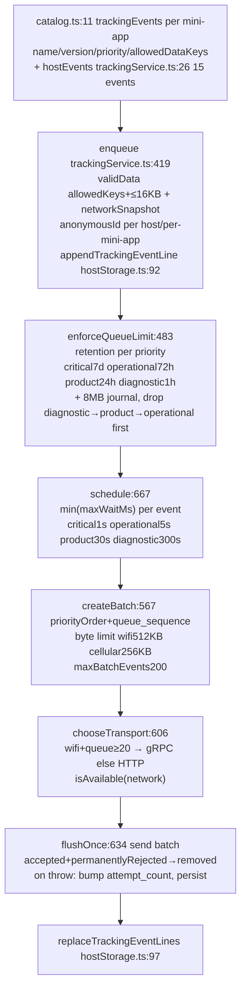

Host derives `event_id session_id anonymous_id platform host_app_version trace_id privacy_class consent_version sdk_version network_at_event` — mini-app supplies only `name/version/allowedData` (`app/docs/mini-app-platform-standard.md:357`).

### 2.6 Notification — push → inbox → activation

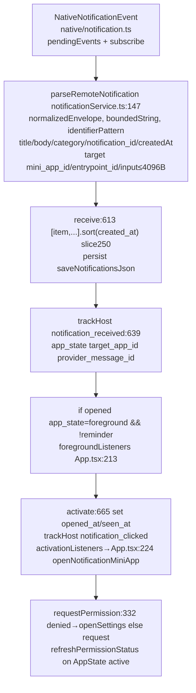

Config `appConfig.ts:52` `maxInboxItems250 maxSeenIdsPerEvent50 reminderLeadMs1h`.

### 2.7 Tenancy — location-first on one binary

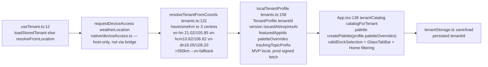

Tenants `tenants.ts:32` `vn-hn/CHN prim #3B5BDB` `vn-hcm/HCM #E8590C` `vn-dn/ĐN #0B7285`.

### 2.8 Design tokens — single animation language

Palette `palette.ts:57` 24 semantic tokens; mini-app receives 18 via `miniAppPaletteFrom:87` (no glass/scrim/shadow/statusBar). Motion `motion.ts:34` `feedback100 standard200 emphasized300 travel24` reduced-motion zeros all `reduceMotion:158`. Budgets `budgets.ts:10` `FRAME16.67 TAP100 SPLASH50/100 BRIDGE5/16 WARM350/800 COLD700/1500 MAX3`.

---

## 3 — Feature Sequence Diagrams

### 3.1 App launch + tenant resolution

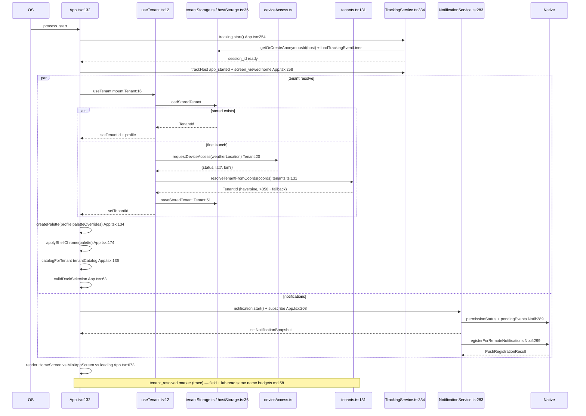

### 3.2 Open mini-app from dock / tab bar

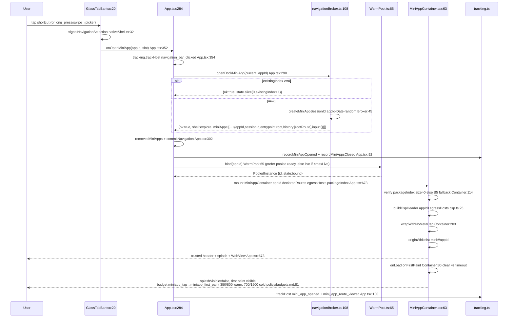

Alternative entry via `MiniAppPickerModal.tsx` `selectDockApp:416` → `saveDockSelection:428` → `openMiniApp:446` same flow.

### 3.3 Internal route navigation (declared pages)

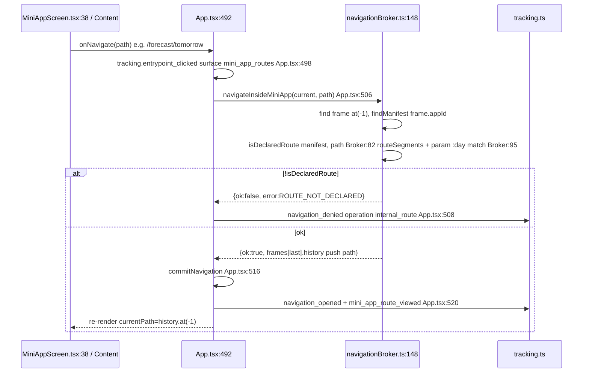

### 3.4 Cross-app link (approved, input-allowlisted)

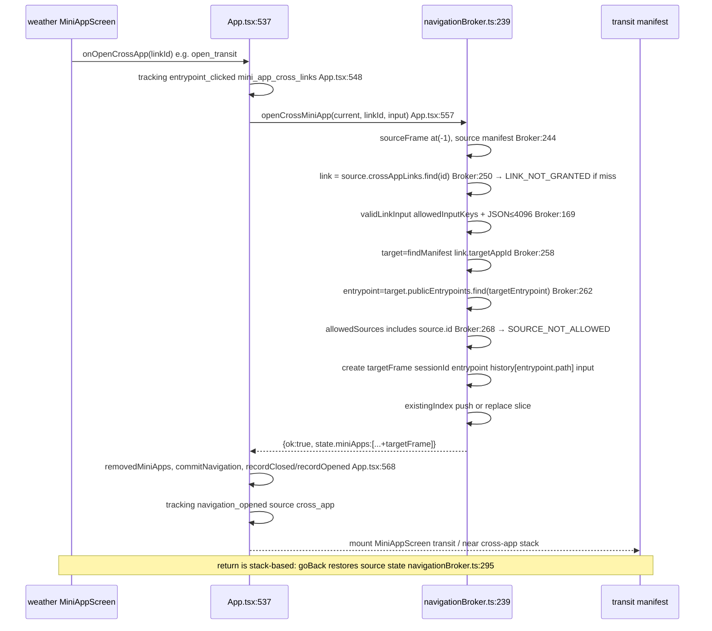

Catalog example `catalog.ts:155` weather→transit `open_transit` `allowedInputKeys:[area]` and reverse `transit→weather`.

### 3.5 Bridge capability call — full 10 steps (scanner.scan example)

```mermaid
sequenceDiagram
    participant JS as Mini-App JS (untrusted)
    participant WV as WebView binding (origin mini://weather)
    participant Transport as RN WebView bridge transport
    participant Handler as handler.ts:47 handleBridgeRequest
    participant Gates as gates.ts
    participant Impl as handlers/scanner.ts
    participant Audit as audit.ts
    JS->>WV: postMessage {id, capability:scanner.scan, operation:scan, version:1, args:{}}
    WV->>Transport: inject with derived session<br/>appId=weather tenantId=vn-hn userId=anon-per-(app,tenant,user)<br/>origin=mini://weather isMainFrame=true (C3 types.ts:34)
    Transport->>Handler: handleBridgeRequest(req, ctx)
    Note over Handler,Gates: Step 1-2 mainFrame assert Handler:58 else audit fail + CAPABILITY_NOT_DECLARED
    Handler->>Gates: gate1Declaration(session, scanner.scan, manifestCapabilities) Handler:78
    alt G1 fail (not in manifest or not in registry R1)
        Gates-->>Handler: {pass:false, CAPABILITY_NOT_DECLARED}
        Handler->>Audit: appendAudit gate1:fail Handler:61
        Handler-->>JS: {ok:false, error:CAPABILITY_NOT_DECLARED} (B6)
    else G1 pass
        Handler->>Handler: Step 4 args object check Handler:99 → INVALID_ARGUMENT
        Handler->>Gates: gate2Consent scanner.scan once Gates:32
        alt no record or expired
            Gates-->>Handler: CONSENT_REQUIRED
            Handler->>Audit: appendAudit gate2:fail Handler:122
            Handler-->>JS: CONSENT_REQUIRED (host shows ConsentSheet)
        else G2 pass
            Handler->>Gates: gate3OsPermission scanner.scan Handler:141 (osState not_required for this cap)
            alt os denied
                Gates-->>Handler: OS_DENIED
                Handler->>Audit: gate3:fail Handler:143
                Handler-->>JS: OS_DENIED
            else pass
                Handler->>Gates: checkQuota bucket now cost1 10/2 Handler:161
                alt RATE_LIMITED
                    Gates-->>Handler: retryAfterMs
                    Handler->>Audit: RATE_LIMITED Handler:170
                    Handler-->>JS: {ok:false, RATE_LIMITED, retryAfterMs}
                else allowed
                    Handler->>Handler: find handler handlers.get(scanner.scan) Handler:187
                    Handler->>Impl: withTimeout(handler(session,args), BRIDGE_ROUND_TRIP_P95_MS*4) Handler:209
                    alt impl throws/timeout
                        Impl-->>Handler: Error('TIMEOUT' / 'INVALID_ARGUMENT')
                        Handler->>Handler: classifyError → closed enum R3 never leaks platform strings Handler:254
                    else success
                        Impl-->>Handler: data (e.g. decoded string, pixels never cross bridge)
                    end
                    Handler->>Audit: appendAudit gate1:pass gate2:pass gate3:pass error? Handler:219 (B7 before reply)
                    Handler-->>JS: Step10 exactly one terminal reply B6 {ok:true,data} or {ok:false,error,message}
                end
            end
        end
    end
    Note over JS,Audit: broker_ui=host_scanner — pixels never cross bridge capabilities.yaml:125<br/>quota sustained:10 burst:2 audit:call_with_result · bridge p95 16ms budgets.ts:14
```

All six caps share the same pipeline; G2/G3/quota values are per-cap definition. Timeouts always yield `TIMEOUT` terminal reply `handler.test.ts`.

### 3.6 Notification push → inbox → foreground banner → open entrypoint

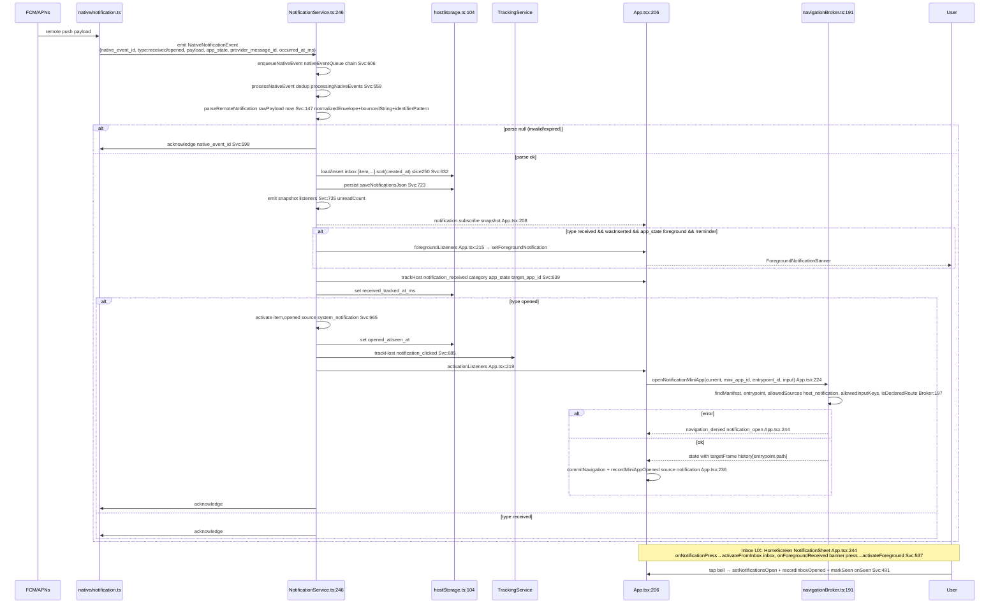

Permission: `requestPermission:332` `denied→openSettings` `not_determined→request` else emit. `refreshPermissionStatus` on `AppState active` `App.tsx:267`.

### 3.7 Tracking end-to-end (mini-app event example)

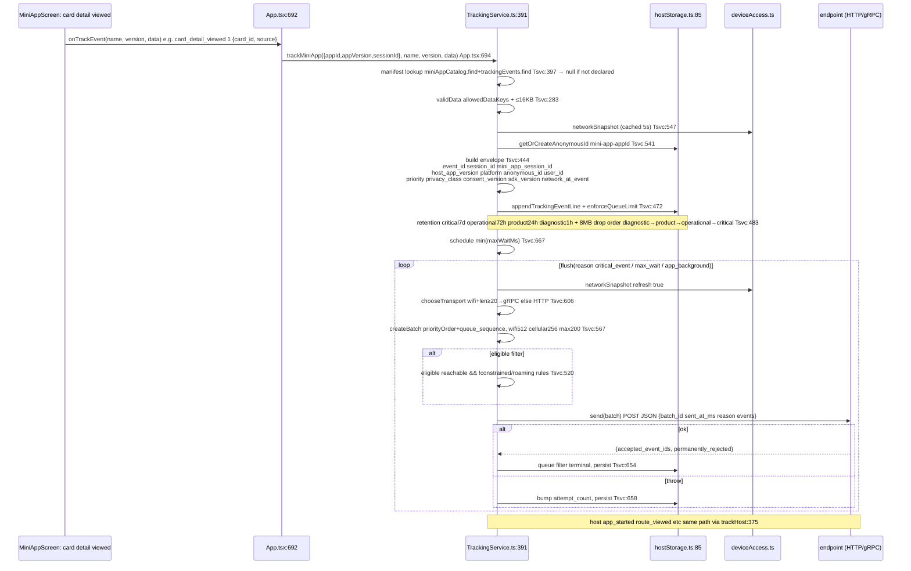

Budgets `appConfig.ts:21` `maxQueueBytes 8MB maxBatchBytes512 maxBatchEvents200`.

### 3.8 Home — pin categories & mini-apps

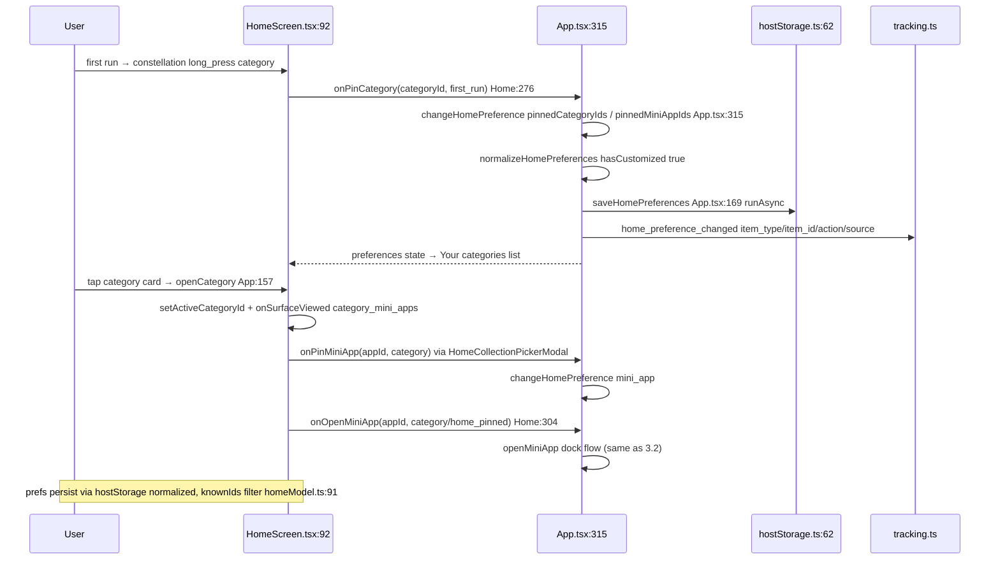

### 3.9 Warm pool lifecycle + memory pressure

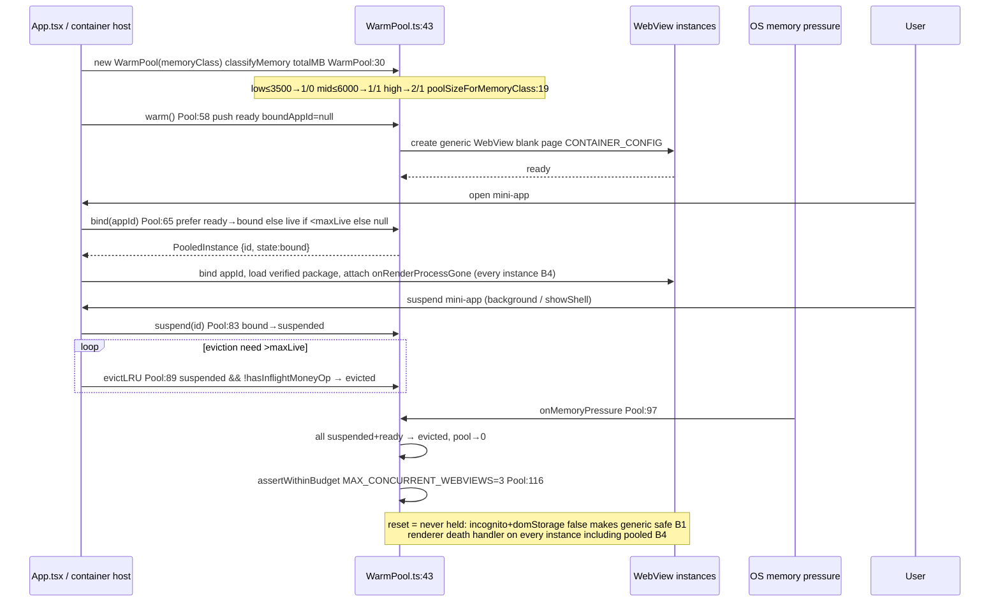

### 3.10 Package review pipeline (sign → CSP → declared-vs-actual)

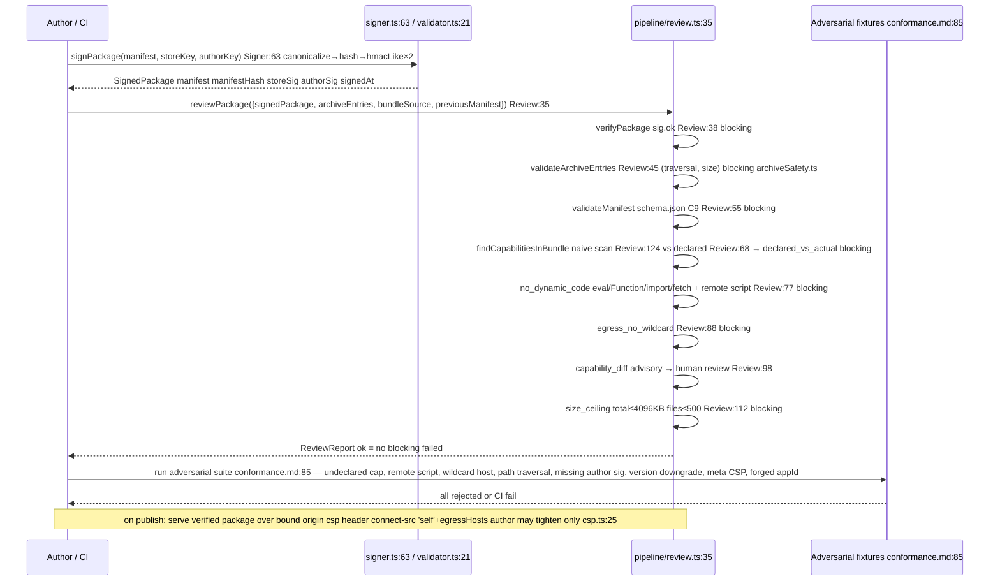

### 3.11 Back / close navigation

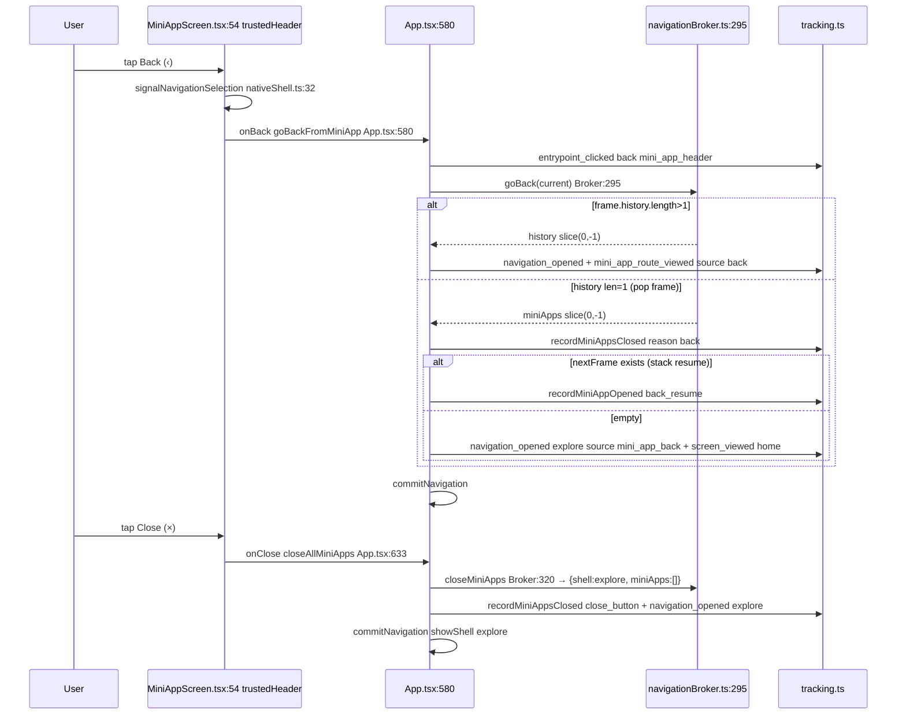

---

## File index (where to look)

- Orchestration `app/App.tsx:132` + `app/App.tsx:673` screen switch + `app/src/native/nativeShell.ts:19`
- Navigation pure `app/src/navigation/navigationBroker.ts:21`
- Tenancy `app/src/hooks/useTenant.ts:12` `app/src/config/tenants.ts:32` `app/src/config/tenantStorage.ts`
- Bridge `app/src/bridge/types.ts:14` `app/src/bridge/registry.ts:24` `app/src/bridge/handler.ts:47` `app/src/bridge/gates.ts:15` `app/src/bridge/handlers/*` `app/src/bridge/audit.ts`
- Container `app/src/miniapps/container/MiniAppContainer.tsx:63` `containerConfig.ts:12` `csp.ts:25` `navigationGuard.ts:30` `warmPool.ts:43`
- Manifest/sign/review `app/src/miniapps/manifest/signer.ts:63` `validator.ts:21` `archiveSafety.ts` `app/src/miniapps/pipeline/review.ts:35` `app/docs/mini-app-platform-standard.md:52`
- Catalog `app/src/miniapps/catalog.ts:44` `catalogTenant.ts` `app/src/home/homeModel.ts:18`
- Tracking `app/src/tracking/trackingService.ts:297` `types.ts` `app/src/native/hostStorage.ts:62` `app/src/config/budgets.ts:10`
- Notifications `app/src/notification/notificationService.ts:246` `types.ts` `app/src/native/notification.ts`
- Design tokens `app/src/config/palette.ts:57` `motion.ts:34` `miniAppDesignTokens.ts` `layout.ts` `appConfig.ts:13`
- Policy `policy/budgets.md:68` `policy/capabilities.yaml:22` `policy/conformance.md:35` `.claude/skills/*`

---

*Budgets are provisional until baselined on Galaxy A14 per `policy/budgets.md:34`; ratchet beats absolute per `CLAUDE.md` mechanisms section. Treat any `95ms` claim as derived/perceptual until field p95 is measured.*
