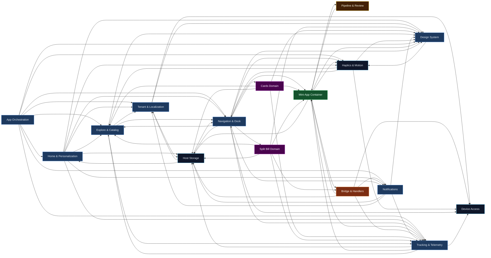
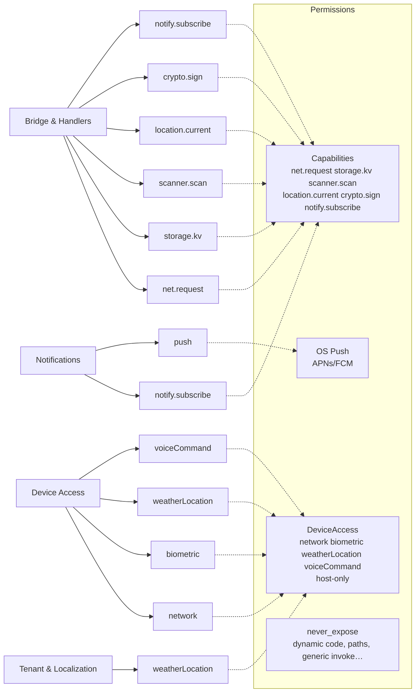

# Feature Graph — dependency trees (3 scopes)

> Generated 2026-09-02T09:13:19.816Z · sources: policy/capabilities.yaml · src/bridge/registry.ts · import scan
> Scope: ONLY feature→feature, feature→components, feature→permissions. Nothing else belongs here.
> Refresh: `npm run feature:graph` after every feature/component/permission change.

Render mermaid with GitHub/VS Code or open `feature-graph.html`.

---

## §1 Feature → Feature

What calls what. Edges are directed; reason + evidence are load-bearing.

| From | To | Reason | Evidence |
|------|----|--------|----------|
| `app` | `home` | App renders HomeScreen, persists home prefs | `App.tsx:HomeScreen` |
| `app` | `navigation` | App owns navigation state + GlassTabBar | `App.tsx:navigationBroker` |
| `app` | `explore` | Explore sheet + picker modals | `App.tsx:ExploreSheet MiniAppPickerModal` |
| `app` | `tenant` | useTenant() tenant resolution + picker | `App.tsx:useTenant tenantPickerOpen` |
| `app` | `notifications` | Inbox + foreground banner + activation | `App.tsx:notification.subscribe onForegroundReceived` |
| `app` | `tracking` | trackHost on every nav/home/close | `App.tsx:tracking.trackHost` |
| `app` | `haptics` | applyShellChrome + selection signals | `App.tsx:applyShellChrome signalNavigationSelection` |
| `home` | `explore` | Category/mini-app catalog + tenant-filtered picks | `src/screens/HomeScreen.tsx:catalogForTenant findMiniApp` |
| `home` | `navigation` | Open/pin triggers dock/nav actions | `src/screens/HomeScreen.tsx:onOpenMiniApp onPin` |
| `home` | `tracking` | Scroll depth + surface viewed + preference changed | `src/screens/HomeScreen.tsx:onScrollDepth onSurfaceViewed` |
| `home` | `tenant` | orders suggestions by viewerProfile + tenant | `src/home/homeModel.ts:orderHomeCategorySuggestions` |
| `home` | `designSystem` | HomeCollection palette/motion, GlassTabBar excluded | `src/components/HomeCollection.tsx:palette` |
| `home` | `storage` | home prefs persisted via hostStorage | `src/native/hostStorage.ts:saveHomePreferences` |
| `navigation` | `explore` | Dock selection validated against catalog | `src/navigation/navigationBroker.ts:openDockMiniApp findMiniApp` |
| `navigation` | `container` | Cross-app link source validation | `src/navigation/navigationBroker.ts:openCrossMiniApp` |
| `navigation` | `tracking` | Route viewed + nav denied | `src/screens/MiniAppScreen.tsx:onTrackEvent` |
| `navigation` | `haptics` | Tab selection haptics | `src/components/GlassTabBar.tsx:signalNavigationSelection` |
| `navigation` | `storage` | Dock selection persisted | `src/native/hostStorage.ts:saveDockSelection` |
| `explore` | `tenant` | Tenant-filtered featured set | `src/miniapps/catalogTenant.ts:catalogForTenant` |
| `explore` | `navigation` | Explore open triggers navigation | `src/components/ExploreSheet.tsx:onOpenMiniApp` |
| `tenant` | `storage` | Tenant persisted | `src/config/tenantStorage.ts:saveStoredTenant` |
| `tenant` | `deviceAccess` | Location-first resolve (host-only weatherLocation) | `src/hooks/useTenant.ts:requestDeviceAccess weatherLocation` |
| `tenant` | `designSystem` | Palette overrides per tenant profile | `src/config/tenants.ts:paletteOverrides` |
| `container` | `pipeline` | Only renders after verifyPackage before first paint | `src/miniapps/container/MiniAppContainer.tsx:verifyPackage` |
| `container` | `storage` | domStorageEnabled=false incognito pool safety | `src/miniapps/container/containerConfig.ts:domStorageEnabled false` |
| `container` | `tracking` | Trace markers for container timing | `src/miniapps/container/MiniAppContainer.tsx:budgets TRACE_MARKERS` |
| `container` | `haptics` | Reduced motion inside container | `src/miniapps/container/MiniAppContainer.tsx:useReducedMotion` |
| `container` | `bridge` | Bridge injected via native reply channel, not RN JS | `src/bridge/handler.ts:handleBridgeRequest` |
| `pipeline` | `container` | Validator/signer shared with container B5 | `src/miniapps/pipeline/review.ts:validateManifest verifyPackage` |
| `bridge` | `container` | Session identity derived from WebView binding | `src/bridge/handler.ts:BridgeSession` |
| `bridge` | `storage` | storage.kv is per-(tenant,appId,user) scoped | `src/bridge/handlers/storageKv.ts` |
| `bridge` | `tracking` | Every handler emits audit before reply | `src/bridge/audit.ts` |
| `bridge` | `notifications` | notify.subscribe handler | `src/bridge/handlers/notifySubscribe.ts` |
| `bridge` | `deviceAccess` | location.current derived, scanner host UI | `src/bridge/handlers/locationCurrent.ts scanner.ts` |
| `tracking` | `storage` | Durable journal 8 MB on disk | `src/tracking/trackingService.ts:retentionMs durableJournal` |
| `tracking` | `container` | mini_app_opened / route_viewed emitted by container nav | `src/tracking/types.ts` |
| `notifications` | `navigation` | Tap notification activates target mini-app entrypoint | `src/notification/notificationService.ts:onActivated target.mini_app_id` |
| `notifications` | `tracking` | notification_opened / permission status | `src/notification/notificationService.ts:tracking` |
| `notifications` | `storage` | Inbox persisted, seen ids | `src/notification/notificationService.ts` |
| `notifications` | `tenant` | Per-tenant featured may affect notification targets | `App.tsx:tenantCatalog` |
| `cards` | `container` | Card mini-app uses container CSP + signing | `src/cards/model.ts` |
| `cards` | `tracking` | Card tracking events (budget view) | `src/cards/model.test.ts` |
| `cards` | `explore` | Card appears in catalogTenant featured | `src/miniapps/catalog.ts:card` |
| `splitBill` | `container` | Split Bill mini-app uses container CSP + signing | `src/splitBill/model.ts` |
| `splitBill` | `tracking` | Split Bill tracking events (bill_created/settled) | `src/splitBill/model.test.ts` |
| `splitBill` | `explore` | Split Bill appears in catalogTenant featured | `src/miniapps/catalog.ts:split-bill` |
| `splitBill` | `storage` | Bill draft persisted via storage.kv | `src/splitBill/storage.ts` |
| `splitBill` | `designSystem` | SplitBillBody uses palette tokens | `src/components/SplitBillBody.tsx:palette` |
| `splitBill` | `bridge` | VietQR paste/scan via net.request + scanner.scan | `src/splitBill/vietqr.ts` |
| `designSystem` | `haptics` | Tokens include motion → reduceMotion controls surfaces | `src/config/motion.ts:reduceMotion` |
| `haptics` | `deviceAccess` | Haptics via nativeShell, not WebView | `src/native/nativeShell.ts:signalNavigationSelection` |
| `cards` | `storage` | import scan | `auto: cards imports storage` |
| `cards` | `designSystem` | import scan | `auto: cards imports designSystem` |
| `explore` | `designSystem` | import scan | `auto: explore imports designSystem` |
| `explore` | `tracking` | import scan | `auto: explore imports tracking` |
| `notifications` | `designSystem` | import scan | `auto: notifications imports designSystem` |
| `haptics` | `designSystem` | import scan | `auto: haptics imports designSystem` |
| `haptics` | `explore` | import scan | `auto: haptics imports explore` |
| `haptics` | `navigation` | import scan | `auto: haptics imports navigation` |
| `home` | `haptics` | import scan | `auto: home imports haptics` |
| `home` | `notifications` | import scan | `auto: home imports notifications` |
| `app` | `designSystem` | import scan | `auto: app imports designSystem` |
| `storage` | `tenant` | import scan | `auto: storage imports tenant` |
| `storage` | `home` | import scan | `auto: storage imports home` |
| `storage` | `navigation` | import scan | `auto: storage imports navigation` |
| `container` | `designSystem` | import scan | `auto: container imports designSystem` |
| `navigation` | `designSystem` | import scan | `auto: navigation imports designSystem` |
| `navigation` | `cards` | import scan | `auto: navigation imports cards` |
| `navigation` | `splitBill` | import scan | `auto: navigation imports splitBill` |
| `navigation` | `deviceAccess` | import scan | `auto: navigation imports deviceAccess` |
| `tracking` | `explore` | import scan | `auto: tracking imports explore` |
| `tracking` | `deviceAccess` | import scan | `auto: tracking imports deviceAccess` |

All 72 edges include 51 hand-maintained + 21 auto-detected via import scan.

---

## §2 Feature → Components

What renders or owns what — screens, components, hooks, services, native modules, scripts.

```mermaid
flowchart TB
  subgraph app["App Orchestration — host"]
    app_App_tsx["App.tsx"]
    app_src_hooks_useTenant_ts["src/hooks/useTenant.ts"]
    app_src_config_appConfig_ts["src/config/appConfig.ts"]
  end
  subgraph home["Home & Personalization — host"]
    home_src_screens_HomeScreen_t["src/screens/HomeScreen.tsx"]
    home_src_home_homeModel_ts["src/home/homeModel.ts"]
    home_src_components_HomeColle["src/components/HomeCollection.tsx"]
    home_src_components_HomeColle["src/components/HomeCollectionPickerModal.tsx"]
    home_src_components_CardCatal["src/components/CardCatalogBody.tsx"]
    home_src_components_TrackedSc["src/components/TrackedScrollView.tsx"]
  end
  subgraph navigation["Navigation & Dock — host"]
    navigation_src_navigation_navigatio["src/navigation/navigationBroker.ts"]
    navigation_src_components_GlassTabB["src/components/GlassTabBar.tsx"]
    navigation_src_screens_MiniAppScree["src/screens/MiniAppScreen.tsx"]
    navigation_src_screens_PlaceholderS["src/screens/PlaceholderScreen.tsx"]
    navigation_src_native_nativeShell_t["src/native/nativeShell.ts"]
  end
  subgraph explore["Explore & Catalog — host"]
    explore_src_components_ExploreSh["src/components/ExploreSheet.tsx"]
    explore_src_components_MiniAppPi["src/components/MiniAppPickerModal.tsx"]
    explore_src_components_TenantPic["src/components/TenantPickerSheet.tsx"]
    explore_src_miniapps_catalog_ts["src/miniapps/catalog.ts"]
    explore_src_miniapps_catalogTena["src/miniapps/catalogTenant.ts"]
    explore_src_miniapps_sample_Samp["src/miniapps/sample/SampleMiniApp.tsx"]
  end
  subgraph tenant["Tenant & Localization — host"]
    tenant_src_config_tenants_ts["src/config/tenants.ts"]
    tenant_src_config_tenantStorage["src/config/tenantStorage.ts"]
    tenant_src_hooks_useTenant_ts["src/hooks/useTenant.ts"]
    tenant_src_components_TenantPic["src/components/TenantPickerSheet.tsx"]
  end
  subgraph container["Mini-App Container — container"]
    container_src_miniapps_container_M["src/miniapps/container/MiniAppContainer.tsx"]
    container_src_miniapps_container_c["src/miniapps/container/containerConfig.ts"]
    container_src_miniapps_container_c["src/miniapps/container/csp.ts"]
    container_src_miniapps_container_n["src/miniapps/container/navigationGuard.ts"]
    container_src_miniapps_container_w["src/miniapps/container/warmPool.ts"]
    container_src_miniapps_manifest_si["src/miniapps/manifest/signer.ts"]
    container_src_miniapps_manifest_va["src/miniapps/manifest/validator.ts"]
    container_src_miniapps_manifest_ar["src/miniapps/manifest/archiveSafety.ts"]
    container_more["… +1 more"]
  end
  subgraph pipeline["Pipeline & Review — governance"]
    pipeline_src_miniapps_pipeline_re["src/miniapps/pipeline/review.ts"]
    pipeline_src_miniapps_manifest_va["src/miniapps/manifest/validator.ts"]
    pipeline_src_miniapps_manifest_si["src/miniapps/manifest/signer.ts"]
    pipeline_app_scripts_miniapp_sign["app/scripts/miniapp-sign.mjs"]
    pipeline_app_scripts_verify_sh["app/scripts/verify.sh"]
  end
  subgraph bridge["Bridge & Handlers — bridge"]
    bridge_src_bridge_registry_ts["src/bridge/registry.ts"]
    bridge_src_bridge_handler_ts["src/bridge/handler.ts"]
    bridge_src_bridge_gates_ts["src/bridge/gates.ts"]
    bridge_src_bridge_register_ts["src/bridge/register.ts"]
    bridge_src_bridge_audit_ts["src/bridge/audit.ts"]
    bridge_src_bridge_types_ts["src/bridge/types.ts"]
    bridge_src_bridge_handlers_netR["src/bridge/handlers/netRequest.ts"]
    bridge_src_bridge_handlers_stor["src/bridge/handlers/storageKv.ts"]
    bridge_more["… +4 more"]
  end
  subgraph tracking["Tracking & Telemetry — host"]
    tracking_src_tracking_trackingSer["src/tracking/trackingService.ts"]
    tracking_src_tracking_trace_ts["src/tracking/trace.ts"]
    tracking_src_tracking_types_ts["src/tracking/types.ts"]
    tracking_src_components_TrackedSc["src/components/TrackedScrollView.tsx"]
    tracking_src_config_budgets_ts["src/config/budgets.ts"]
  end
  subgraph notifications["Notifications — host"]
    notifications_src_notification_notific["src/notification/notificationService.ts"]
    notifications_src_notification_index_t["src/notification/index.ts"]
    notifications_src_notification_types_t["src/notification/types.ts"]
    notifications_src_components_Notificat["src/components/NotificationSheet.tsx"]
    notifications_src_components_Foregroun["src/components/ForegroundNotificationBanner.tsx"]
    notifications_src_native_notification_["src/native/notification.ts"]
    notifications_src_config_remotePush_ts["src/config/remotePush.ts"]
  end
  subgraph deviceAccess["Device Access — native"]
    deviceAccess_src_native_deviceAccess_["src/native/deviceAccess.ts"]
    deviceAccess_src_utils_withTimeout_ts["src/utils/withTimeout.ts"]
  end
  subgraph storage["Host Storage — native"]
    storage_src_native_hostStorage_t["src/native/hostStorage.ts"]
    storage_src_config_tenantStorage["src/config/tenantStorage.ts"]
    storage_src_miniapps_container_c["src/miniapps/container/containerConfig.ts"]
  end
  subgraph cards["Cards Domain — domain"]
    cards_src_cards_model_ts["src/cards/model.ts"]
    cards_src_cards_cardStore_ts["src/cards/cardStore.ts"]
    cards_src_cards_dataset_ts["src/cards/dataset.ts"]
    cards_src_components_CardCatal["src/components/CardCatalogBody.tsx"]
  end
  subgraph splitBill["Split Bill Domain — domain"]
    splitBill_src_splitBill_model_ts["src/splitBill/model.ts"]
    splitBill_src_splitBill_vietqr_ts["src/splitBill/vietqr.ts"]
    splitBill_src_splitBill_banks_ts["src/splitBill/banks.ts"]
    splitBill_src_splitBill_i18n_ts["src/splitBill/i18n.ts"]
    splitBill_src_splitBill_storage_ts["src/splitBill/storage.ts"]
    splitBill_src_components_SplitBill["src/components/SplitBillBody.tsx"]
  end
  subgraph designSystem["Design System — host"]
    designSystem_src_ui_foundations_token["src/ui/foundations/tokens.ts"]
    designSystem_src_ui_primitives_Box_ts["src/ui/primitives/Box.tsx"]
    designSystem_src_ui_primitives_Text_t["src/ui/primitives/Text.tsx"]
    designSystem_src_ui_primitives_Pressa["src/ui/primitives/Pressable.tsx"]
    designSystem_src_ui_primitives_Divide["src/ui/primitives/Divider.tsx"]
    designSystem_src_ui_actions_Button_ts["src/ui/actions/Button.tsx"]
    designSystem_src_ui_actions_IconButto["src/ui/actions/IconButton.tsx"]
    designSystem_src_config_palette_ts["src/config/palette.ts"]
    designSystem_more["… +4 more"]
  end
  subgraph haptics["Haptics & Motion — native"]
    haptics_src_native_nativeShell_t["src/native/nativeShell.ts"]
    haptics_src_native_haptics_ts["src/native/haptics.ts"]
    haptics_src_config_motion_ts["src/config/motion.ts"]
    haptics_src_config_useReducedMot["src/config/useReducedMotion.ts"]
    haptics_src_components_GlassTabB["src/components/GlassTabBar.tsx"]
  end

```

| Feature | Label | Components |
|---------|-------|------------|
| `app` | App Orchestration | `App.tsx` `src/hooks/useTenant.ts` `src/config/appConfig.ts` |
| `home` | Home & Personalization | `src/screens/HomeScreen.tsx` `src/home/homeModel.ts` `src/components/HomeCollection.tsx` `src/components/HomeCollectionPickerModal.tsx` `src/components/CardCatalogBody.tsx` `src/components/TrackedScrollView.tsx` |
| `navigation` | Navigation & Dock | `src/navigation/navigationBroker.ts` `src/components/GlassTabBar.tsx` `src/screens/MiniAppScreen.tsx` `src/screens/PlaceholderScreen.tsx` `src/native/nativeShell.ts` |
| `explore` | Explore & Catalog | `src/components/ExploreSheet.tsx` `src/components/MiniAppPickerModal.tsx` `src/components/TenantPickerSheet.tsx` `src/miniapps/catalog.ts` `src/miniapps/catalogTenant.ts` `src/miniapps/sample/SampleMiniApp.tsx` |
| `tenant` | Tenant & Localization | `src/config/tenants.ts` `src/config/tenantStorage.ts` `src/hooks/useTenant.ts` `src/components/TenantPickerSheet.tsx` |
| `container` | Mini-App Container | `src/miniapps/container/MiniAppContainer.tsx` `src/miniapps/container/containerConfig.ts` `src/miniapps/container/csp.ts` `src/miniapps/container/navigationGuard.ts` `src/miniapps/container/warmPool.ts` `src/miniapps/manifest/signer.ts` `src/miniapps/manifest/validator.ts` `src/miniapps/manifest/archiveSafety.ts` `src/miniapps/manifest/schema.json` |
| `pipeline` | Pipeline & Review | `src/miniapps/pipeline/review.ts` `src/miniapps/manifest/validator.ts` `src/miniapps/manifest/signer.ts` `app/scripts/miniapp-sign.mjs` `app/scripts/verify.sh` |
| `bridge` | Bridge & Handlers | `src/bridge/registry.ts` `src/bridge/handler.ts` `src/bridge/gates.ts` `src/bridge/register.ts` `src/bridge/audit.ts` `src/bridge/types.ts` `src/bridge/handlers/netRequest.ts` `src/bridge/handlers/storageKv.ts` `src/bridge/handlers/scanner.ts` `src/bridge/handlers/locationCurrent.ts` `src/bridge/handlers/cryptoSign.ts` `src/bridge/handlers/notifySubscribe.ts` |
| `tracking` | Tracking & Telemetry | `src/tracking/trackingService.ts` `src/tracking/trace.ts` `src/tracking/types.ts` `src/components/TrackedScrollView.tsx` `src/config/budgets.ts` |
| `notifications` | Notifications | `src/notification/notificationService.ts` `src/notification/index.ts` `src/notification/types.ts` `src/components/NotificationSheet.tsx` `src/components/ForegroundNotificationBanner.tsx` `src/native/notification.ts` `src/config/remotePush.ts` |
| `deviceAccess` | Device Access | `src/native/deviceAccess.ts` `src/utils/withTimeout.ts` |
| `storage` | Host Storage | `src/native/hostStorage.ts` `src/config/tenantStorage.ts` `src/miniapps/container/containerConfig.ts` |
| `cards` | Cards Domain | `src/cards/model.ts` `src/cards/cardStore.ts` `src/cards/dataset.ts` `src/components/CardCatalogBody.tsx` |
| `splitBill` | Split Bill Domain | `src/splitBill/model.ts` `src/splitBill/vietqr.ts` `src/splitBill/banks.ts` `src/splitBill/i18n.ts` `src/splitBill/storage.ts` `src/components/SplitBillBody.tsx` |
| `designSystem` | Design System | `src/ui/foundations/tokens.ts` `src/ui/primitives/Box.tsx` `src/ui/primitives/Text.tsx` `src/ui/primitives/Pressable.tsx` `src/ui/primitives/Divider.tsx` `src/ui/actions/Button.tsx` `src/ui/actions/IconButton.tsx` `src/config/palette.ts` `src/config/layout.ts` `src/config/motion.ts` `src/config/miniAppDesignTokens.ts` `src/config/useReducedMotion.ts` |
| `haptics` | Haptics & Motion | `src/native/nativeShell.ts` `src/native/haptics.ts` `src/config/motion.ts` `src/config/useReducedMotion.ts` `src/components/GlassTabBar.tsx` |

Total features: 16. Narrow to the files above when reviewing.

---

## §3 Feature → Permissions

What authority a feature needs — bridge capabilities, OS permission, or host-only deviceAccess. A feature with no row needs no permission.

Capabilities registry (`policy/capabilities.yaml:6`  `src/bridge/registry.ts:6` — R1): `net.request`, `storage.kv`, `scanner.scan`, `location.current`, `crypto.sign`, `notify.subscribe`

| Feature | Label | Permission (kind) | Consent | Broker UI | Min tier / via |
|---------|-------|-------------------|---------|-----------|----------------|
| `app` | App Orchestration | — | — | — | — |
| `home` | Home & Personalization | — | — | — | — |
| `navigation` | Navigation & Dock | — | — | — | — |
| `explore` | Explore & Catalog | — | — | — | — |
| `tenant` | Tenant & Localization | `weatherLocation` (deviceAccess) | `—` | `—` | `—` `native/deviceAccess.ts` |
| `container` | Mini-App Container | — | — | — | — |
| `pipeline` | Pipeline & Review | — | — | — | — |
| `bridge` | Bridge & Handlers | `net.request` (capability) | `none` | `false` | `sandbox` `capability` |
| `bridge` | Bridge & Handlers | `storage.kv` (capability) | `none` | `false` | `sandbox` `capability` |
| `bridge` | Bridge & Handlers | `scanner.scan` (capability) | `once` | `host_scanner` | `self_serve` `capability` |
| `bridge` | Bridge & Handlers | `location.current` (capability) | `once` | `false` | `partner_verified` `capability` |
| `bridge` | Bridge & Handlers | `crypto.sign` (capability) | `once` | `biometric_prompt` | `partner_verified` `capability` |
| `bridge` | Bridge & Handlers | `notify.subscribe` (capability) | `while_using` | `false` | `self_serve` `capability` |
| `tracking` | Tracking & Telemetry | — | — | — | — |
| `notifications` | Notifications | `notify.subscribe` (capability) | `while_using` | `false` | `self_serve` `bridge handler notify.subscribe` |
| `notifications` | Notifications | `push` (os) | `—` | `—` | `—` `native/notification.ts` |
| `deviceAccess` | Device Access | `network` (deviceAccess) | `—` | `—` | `—` `native/deviceAccess.ts` |
| `deviceAccess` | Device Access | `biometric` (deviceAccess) | `—` | `—` | `—` `native/deviceAccess.ts` |
| `deviceAccess` | Device Access | `weatherLocation` (deviceAccess) | `—` | `—` | `—` `native/deviceAccess.ts` |
| `deviceAccess` | Device Access | `voiceCommand` (deviceAccess) | `—` | `—` | `—` `native/deviceAccess.ts` |
| `storage` | Host Storage | — | — | — | — |
| `cards` | Cards Domain | — | — | — | — |
| `splitBill` | Split Bill Domain | — | — | — | — |
| `designSystem` | Design System | — | — | — | — |
| `haptics` | Haptics & Motion | — | — | — | — |

### never_expose (not permissions — refusals)

These never become grantable at a higher tier, flag, or deadline:

- dynamic code execution or loading, in any form
- raw filesystem paths, in either direction
- generic or reflective invocation
- host credentials
- persistent cross-app identifiers
- bulk personal data
- clipboard read without an explicit paste gesture
- screen capture, screen recording, accessibility services, overlay windows,
- arbitrary URL or intent launch
- raw biometric material — and "biometry succeeded" as a boolean
- key export
- installing, downloading-and-executing, or side-loading anything
- raw sockets, and generic background-execution primitives
- any host-internal debug or admin capability, even behind a flag

### Mini-app instances (catalog)

`src/miniapps/catalog.ts:6` — `badminton` (Cầu lông), `weather`, `transit`, `notes`, `market`, `card`. Each carries `publicEntrypoints` / `crossAppLinks` / `trackingEvents.allowedDataKeys` — see §1 edges via `catalogTenant` and §2 via `explore` / `container`.

---

## How to maintain

1. Edit feature code.
2. Run `npm run feature:graph` (overwrites json/md/html).
3. Review the diff in this file — added/removed edges are the impact.
4. Commit code + `feature-graph.*` together.

If auto scan misses an edge, add it to `EDGES` in `scripts/feature-graph.mjs`. If it falsely reports one, add to overrides in `feature-graph.config.json` (not yet needed).
